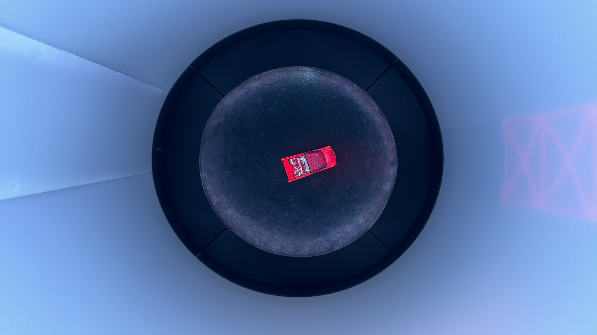
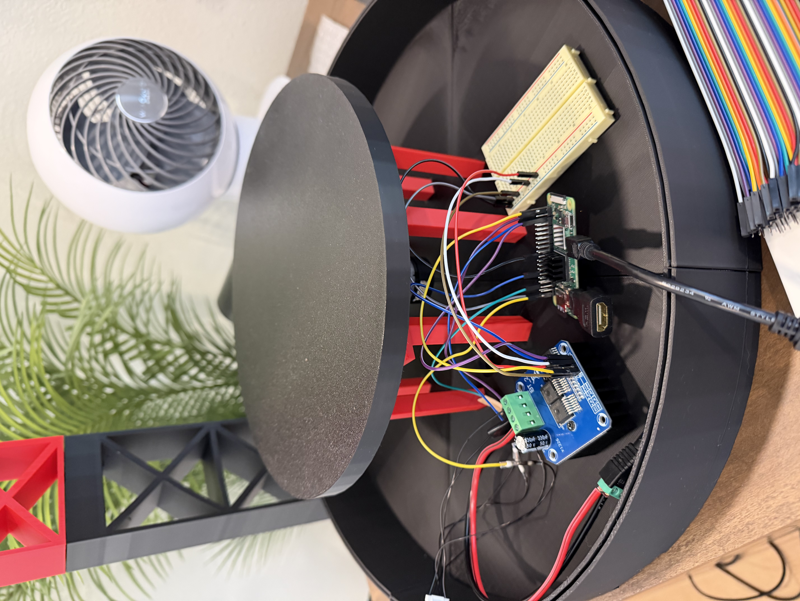
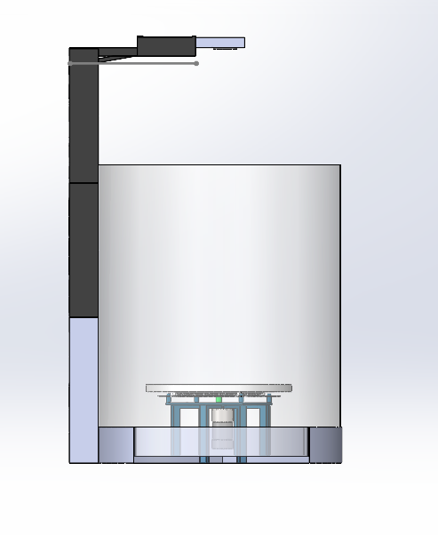
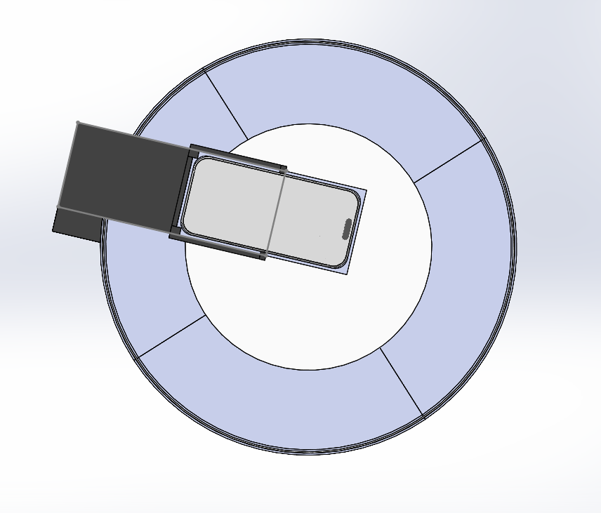
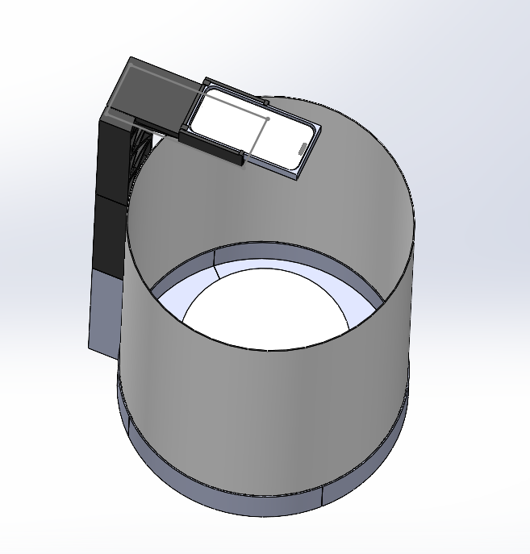
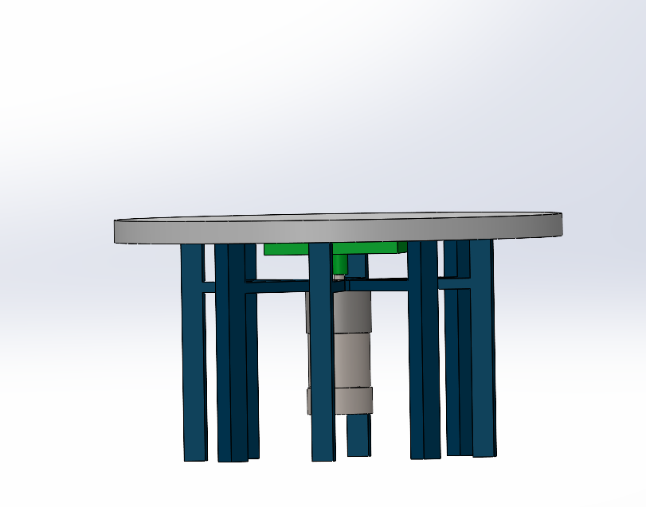

# Sept 15 (~1hr)

I added the rubber and adhesive on to the platform today. This was relatively easy because I can just slip off the platform since it just glides in with the use of pegs, however I had to go slow when I was tracing the platform for the rubber cut in order to have a smooth circle. I also used a compass for the trace of a circle on the adhesive peel. This came in handy because my circle was a lot smoother and it ended out to be quicker. The only drawback to the rubber addition is probably the glare that occurs along the circumference of the circle.

# Sept 7 (4hr 28mins)

I had been working on the github and the coding for my setup. It was tricky because I needed a work around to have my pi access the camera, so I used the Continuity Camera Feature on apple products in order for the code to capture photos. 

# Sept 1 (4hr)

I attched all the parts together and then I worked on the wiring portion of the project. This took me a while because I was new to this. I also had to cut some wires and connect them with a metal heat shrink connector. The nice thing was that all the mess of the wires could just hide away under the platform without being seen. Overall I'm very happy with it and so far so good. 

# Aug 16 (2hr)

I started printing out my CAD files which took 2,252g ($56, 2 days). For the most part the process was easy and there was no probllems. I did have to change one thing before I printed my items and that was just a hole to the center, so my wires can be hidden under the platform. I was worried about how the tower that holds the phone would work out, but it work amazing. 

# Aug 18 (3hr 59m)

It took me a while unitl I knew how I could snap in my phone tower to the base without it leaning. Once I finished the cad I ended up using pegs with a slit between them for tolerance and the head of it had a bigger diameter and once it was pushed in fully it would snap to the cavity I put in the hole in order to make it stable. 

# Aug 7 (~3hrs) 

I worked on the cad for the ecovision setup. I think the hardest part was figuring out how to center the platform with a motor that was off-centered. I made the platform without a bearing, so I need to change that later.
