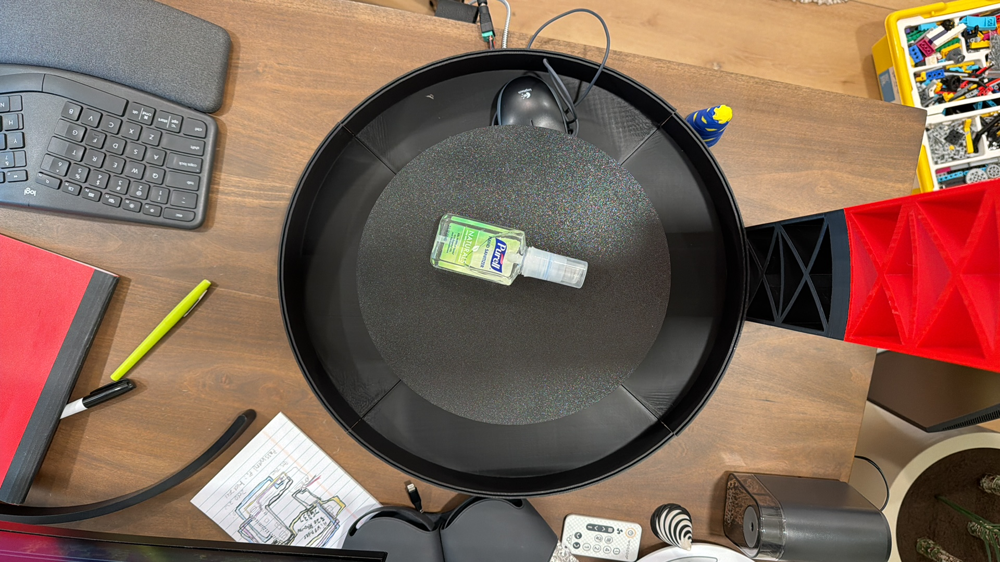
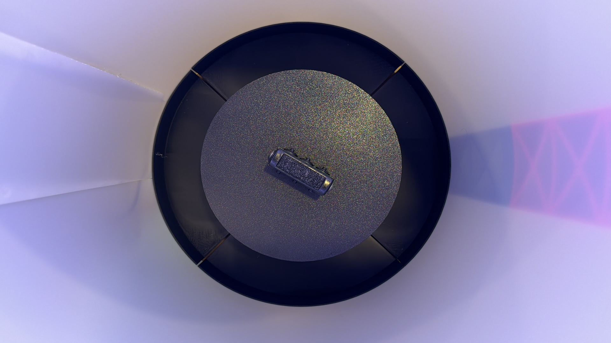
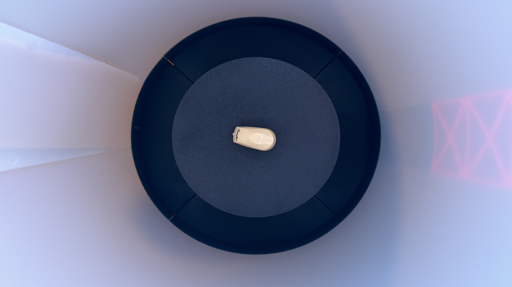

# EcoVision

This repository documents my process of my custom dataset for waste classification. This dataset features 4 classes, trash, recycling, compost, ewaste/hazardous with equal distibution across all classes. This dataset is  effective by having more constants across the images. For example, fixed height, leveled camera, centered camera, consistent lighting, zoom scope. In addition, the dataset is unique by taking a set of images for an item by changing the rotation of an item. With a moving platform controlled by a motor and raspberry pi zero 2w. This results in precise and accurate rotations of the platform. The data collection system is innovative by having a mostly-automated collection process. Since the only manual part of the data collection process is the setting of an item on the platform, naming the item for the dataset, and setting the item in the right class. 

# Deep Dive

## The Parts

The dataset setup uses mainly 3d printed parts. For this project I have used 2,252 grams of filament and it took two days and three hours to print out all the parts. I then used a Hiwonder 520 DC Gear Motor with High-Precision Hall Encoder, 12V, 6mm D-Shaped Eccentric Shaft
Set of 2 / 1:90 (large torque) for moving the platform this was controlled by a raspberry pi zero 2w. I used a bearing from servocity to ensure stable and smooth movements along the platform. For the camera I designed and 3d printed a tower that centers my iphone's camera accordingly. Surronding all of these componets is a polyethylene plastic sheet about 0.055" thick as a wall to create no distractions for the Convolutional Neural Network(CNN) to train on. In addition to the walls there is an LED strip that spans the inner walls creating consistent imaging.   

## The Process

First the item is placed on the platform and then I run 2 programs in order to collect my images. One runs on the pi in order to move the platform and prompt the user what item is on the platform and what class it goes in. While the other program runs on my Macbook Air and acts like a server. So when the program starts on raspberry pi it firsts asks the user for the item name. After that then the pi will move the platform by 90º. Then the raspberry pi's program will request a photo capture on my phone through the program that runs on my Mac. Because of apple's security to not allow devices like the raspberry pi to have access to the camera, I had to use a feature for apple called the iPhone Continuity Camera. This feature allows your Macbook to use your iPhone as a high quality webcam, so I used this feature as a way of collecting high quality photos of these items. The Mac's program then goes through a series of checks to ensure that the inputs are correct. For example, the program checks if the folder name is valid, name of the item is valid, no duplicates are present to ensure no overriding images, and the index is in the right range of 0 - 3(this keeps track of the amount of rotations for one item). After the Mac program captures the first photo it makes a new folder with the name of the item and saves the rest of the images of that item within the folder. Then it tells the pi that it was successfull in saving the image and then the motor moves again and saves the photo by requesting on the Mac's program. This keeps going until a full rotation is complete. Once that is complete the process starts all over again by requesting the new item name.
# Iterations

## First Iteration

Here is the photo of my first image capture on this setup. This was the very bare and simple as a proof of concept.

## Second Iteration

Here is the photo of my second iteration image capture on this setup. This has less distraction in the background, however the lighting is uneven and there is a lot of glare coming off the platform.

## Third Iteration

Here is the photo of my third iteration image capture on this setup. This iteration has little to no glare, balanced lighting and white hues instead of the purple hues. The problem of an item rolling off or shifting during rotation is still present.

## 4th Iteration

This image shows the rubber platform at work. This platform uses a rubber sheet in order to reduce drift and unecessary movement while rotating. As you can see I tested this out with a toy car in order to show the huge difference between the bare PLA platform and the platform with the rubber on top. 

        